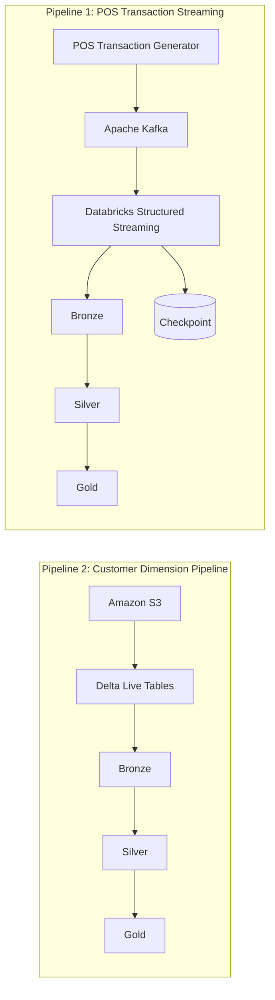

# Real-Time Streaming Pipelines with Databricks
 
Built two streaming pipelines using **Apache Kafka**, **Spark Streaming**, **Delta Live Tables (DLT)**, **Delta Lake Table**, **Amazon S3**, and **Databricks Asset Bundles (DAB)** to process POS transactions with a **Bronze–Silver–Gold** architecture.
 
## Architecture
 

 
## Pipelines
 
### Pipeline 1 — Kafka Streaming Ingestion
 
- Ingested real-time (micro-batch based) POS transactions from Kafka into Delta Lake.
- Built **Bronze → Silver → Gold** transformations with Spark Structured Streaming.
- Implemented checkpointing for fault-tolerant processing.
### Pipeline 2 — Customer Dimension Processing
 
- Processed customer updates from Amazon S3 using Databricks Delta Live Tables (DLT).
- Implemented **Slowly Changing Dimension (SCD) Type 1** and **Type 2** for customer history.
- Deployed and orchestrated workflows with Databricks Asset Bundles (DAB).
## Key Skills Demonstrated
 
- Apache Kafka
- Spark Structured Streaming
- Delta Live Tables (DLT)
- Delta Lake Table with Unity Catalog external location
- SCD Type 1 & Type 2
- Medallion Architecture
- Databricks Asset Bundles (DAB)
- Amazon S3
## Roadmap
 
- [ ] Test the Kafka stream script on the paid Databricks edition instead of the free edition:
the free edition doesn't allow a long-running trigger (`.trigger(processingTime="60 seconds")`) — only `trigger(availableNow=True)` is supported, which makes this a batch-scheduled task for now.
- [ ] Implement data unit tests over dbt and integrate with DLT.
- [ ] Plan and implement the consumer layer table usage for both pipelines: currently only bronze and silver are covered.
- [ ] Plan and implement an efficient way to store Kafka broker information in an S3 bucket for future audits. The Kafka topic currently has a 7-day retention window, so unprocessed data will be lost once that window passes. Besides storing the processed records in the bronze layer table, keep a copy of the raw JSON in a separate storage location for backup and audit purposes.